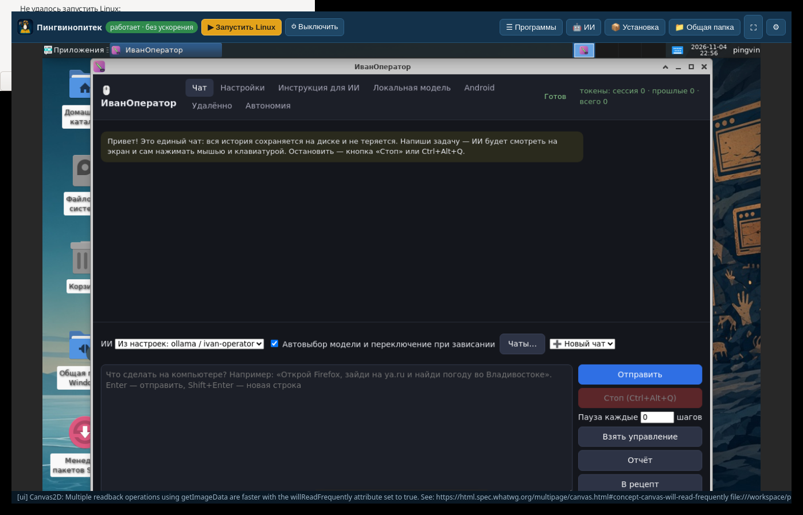

# Пингвинопитек

Linux (Debian 13 + XFCE) внутри Windows x64 со встроенным ИИ — **ИванОператор** (Linux-версия) уже установлен в системе, запускается сам и умеет управлять Linux.

## Как это устроено
- **Приложение Windows** (Electron, установщик NSIS) со встроенным **QEMU 11.1** (qemu.weilnetz.de): ускорение **WHPX** (Hyper-V), если недоступно — программная эмуляция TCG.
- Экран Linux — **noVNC** прямо в окне программы (VNC-websocket QEMU).
- **Буфер обмена** — qemu-vdagent + spice-vdagent; **общая папка** Windows (`%USERPROFILE%\Pingvinopitek`) — WebDAV-сервер в приложении → `/mnt/windows` в Linux (davfs2); сеть — user-mode NAT.
- Панели: **Программы** (список и запуск через qemu-guest-agent), **Установка** пакетов apt из интерфейса, **ИИ** (задача для ИванОператора), выключение / сброс системы.
- Образ: `base.qcow2` (только чтение) + оверлей `disk.qcow2` → «Сбросить систему» возвращает чистое состояние.
- В гостевой системе: пользователь `pingvin` / пароль `pingvin` (sudo без пароля), автовход, русская локаль, раскладка us,ru (Alt+Shift), часовой пояс Asia/Vladivostok.

## Скачать
- Установщик Windows: [Пингвинопитек 1.0.0](https://github.com/ivanivorontsov-sudo/pingvinopitek/releases/tag/v1.0.0) (`Pingvinopitek-Setup-1.0.0.exe`)
- Образ Linux: [image-v1](https://github.com/ivanivorontsov-sudo/pingvinopitek/releases/tag/image-v1) (`pingvinopitek-debian13.qcow2.part00`)

## Установка
1. Скачайте `Pingvinopitek-Setup-*.exe` из релиза и установите.
2. Образ Linux (релиз `image-v1`): скачайте `pingvinopitek-debian13.qcow2.part00` и укажите его в программе. Репозиторий публичный, токен GitHub не обязателен; его можно вписать в ⚙ Настройках, только если анонимная загрузка с GitHub ограничена.
3. Для скорости включите компонент Windows «Платформа низкоуровневой оболочки Windows» (Windows Hypervisor Platform).

## Сборка
- `vm/` — сборка образа: облачный образ Debian trixie + cloud-init (`vm/seed`, `vm/extra/setup.sh`, в `extra/` положить `ivan-operator_1.2.7_amd64.deb`).
- `app/` — `npm install`, распаковать QEMU для Windows в `app/qemu`, `npx electron-builder --win nsis --x64`.
